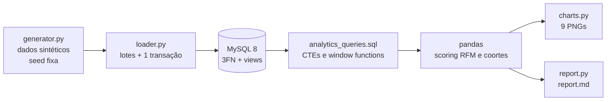
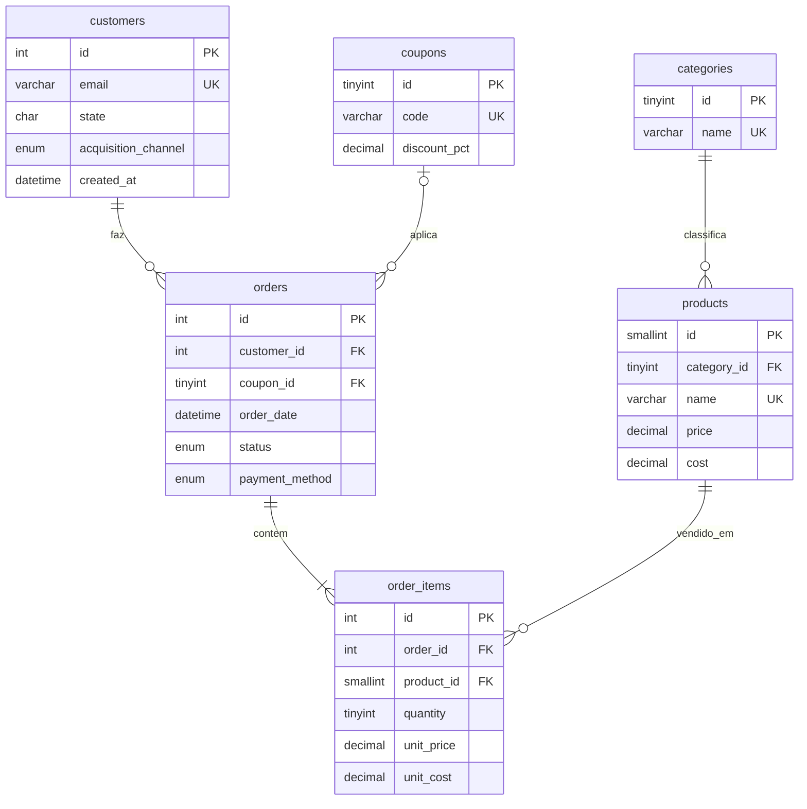
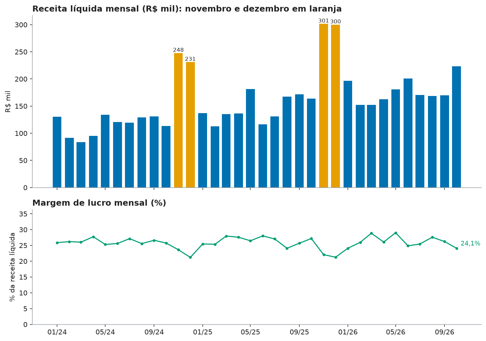
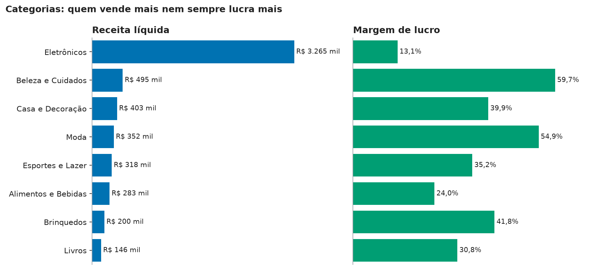
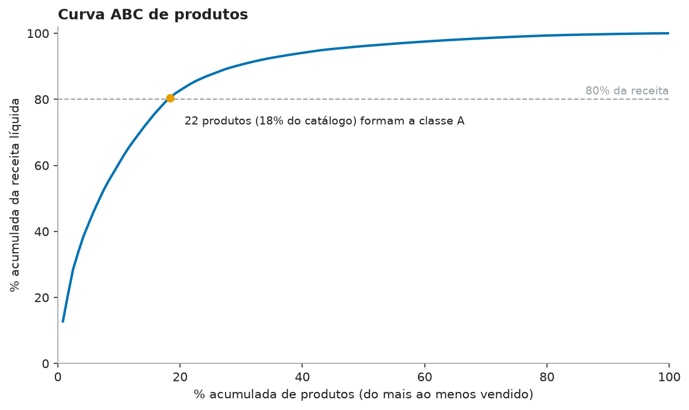
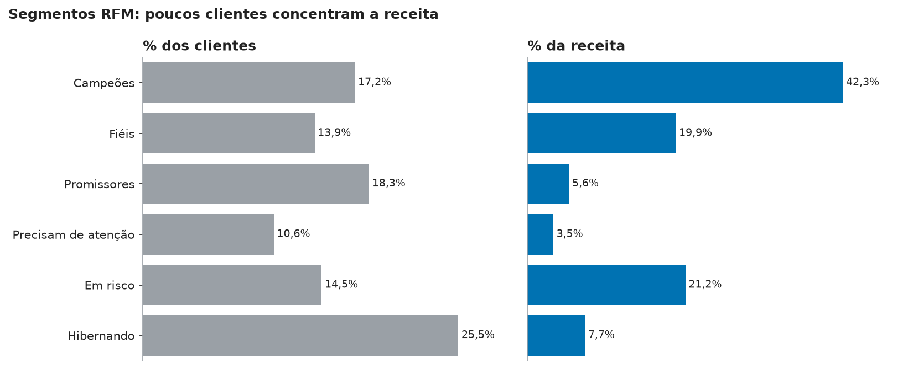
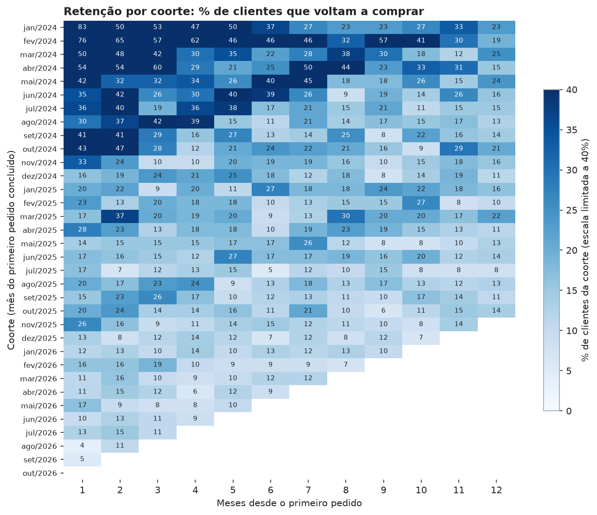

# Loja Aurora: análise de dados de e-commerce com MySQL e Python


Pipeline completo de análise de uma loja de e-commerce **fictícia**: gera dados sintéticos com padrões de negócio embutidos,
carrega em um banco MySQL 8 normalizado, responde a 9 perguntas de negócio com SQL (CTEs e funções de janela),
faz a segmentação RFM em pandas e produz gráficos e um relatório automático com conclusões e recomendações.

> **Todos os dados são fictícios.** Clientes, e-mails (domínio reservado `example.com`) e números foram gerados por script com
> seed fixa. As conclusões descrevem o conjunto simulado, não um negócio real. Os números deste README foram copiados de uma
> execução real do pipeline (seed 42); eles podem diferir em outra versão do Faker ou do NumPy.

## Problema de negócio

A "Loja Aurora" quer entender de onde vem a receita e o lucro, quais produtos e clientes importam mais, e onde há desperdício
(cupons, cancelamentos, canais fracos). O projeto responde a nove perguntas:

1. Receita, lucro e margem por mês, com crescimento mês a mês.
2. Receita e margem por categoria.
3. Curva ABC de produtos.
4. Segmentação de clientes por RFM.
5. Retenção por coortes.
6. Desempenho por canal de aquisição.
7. Impacto dos cupons no ticket e na margem.
8. Cancelamento e devolução por forma de pagamento.
9. Receita por estado.

## Como funciona



A agregação pesada fica no SQL; o pandas faz só o scoring RFM, a matriz de retenção e a formatação.

### Modelo de dados



Duas views em [sql/schema.sql](sql/schema.sql): `vw_item_net_revenue` e `vw_order_net_revenue` (receita líquida por pedido).
As duas **excluem pedidos cancelados e devolvidos**, e a segunda é construída sobre a primeira, para a regra existir em um só lugar.

## Dados sintéticos e padrões embutidos

O gerador ([src/aurora/generator.py](src/aurora/generator.py)) é uma função pura, sem acesso a banco, e produz 5.000 clientes,
120 produtos, 8 categorias, 5 cupons, 12.000 pedidos e 22.355 itens entre 01/01/2024 e 31/10/2026.
Os padrões abaixo foram **plantados de propósito** (e verificados por testes), para as análises terem o que descobrir:

| Padrão plantado | Como |
|---|---|
| Sazonalidade | Fatores por mês, Black Friday (4,5x no dia, 2x nos 3 dias seguintes) e corrida de Natal, sobre tendência de crescimento |
| Pareto nos produtos | Popularidade por lei de potência |
| Canais com qualidades diferentes | Multiplicador de atividade de compra por canal (indicação alta, redes sociais baixa) |
| Boleto cancela mais | 14% de cancelamento contra 3,5% (cartão) e 2% (Pix) |
| Margens diferentes por categoria | Margem média de 16% (Eletrônicos) a 60% (Beleza) |
| Cupons | Mais itens por pedido com cupom e descontos de 5% a 25% |

Como os padrões foram embutidos, **as análises os redescobrem; isso demonstra o método, não uma descoberta sobre o mundo real**.

## Principais resultados (execução real, seed 42)

Fonte: [reports/report.md](reports/report.md), gerado automaticamente.

**Visão geral:** 10.985 pedidos concluídos, receita líquida de R$ 5.460.733, lucro bruto de R$ 1.386.335 (margem de 25,4%),
ticket médio de R$ 497,11. Dos 5.000 clientes cadastrados, 2.604 compraram. 4,7% dos pedidos foram cancelados e 3,8% devolvidos.

**Sazonalidade.** A receita de novembro ficou 102,7% (2024) e 79,6% (2025) acima da média de setembro e outubro.



**Categorias.** Eletrônicos geram 59,8% da receita, mas com a menor margem (13,1%); Beleza e Cuidados tem a maior (59,7%) com 9,1% da receita.
O peso dos Eletrônicos vem dos parâmetros de preço do gerador (itens de R$ 250 a R$ 4.500), então é um efeito da simulação.



**Curva ABC.** 22 produtos (18% do catálogo) formam a classe A; os 24 mais vendidos (20%) geram 82,7% da receita.



**RFM.** Os Campeões são 17,2% dos clientes e geram 42,3% da receita. O segmento Em risco (3 ou mais pedidos, mas inativo há muito tempo) soma 21,2% da receita histórica.



**Canais.** Indicação gera R$ 1.797,14 de receita por cliente adquirido, contra R$ 605,18 de redes sociais (3,0x).
A base não tem custo de marketing, então não há CAC nem ROAS.

**Cupons.** Pedidos com cupom têm margem de 15,9%, contra 27,6% sem cupom; o BLACK25 (25% de desconto) fica com 0,6% de margem.

**Pagamento.** O boleto cancela 13,5% dos pedidos, contra 3,2% nas demais formas (4,3x).

**Retenção.** Na média simples das coortes, 26,3% dos clientes voltam a comprar no mês 1, 22,3% no mês 3 e 18,1% no mês 6.
Esses valores refletem a simulação (atividade por cliente sorteada), não um benchmark de mercado.



Os demais gráficos (cupons, pagamento, estados) estão em [reports/figures/](reports/figures/) e no relatório.

## Como executar

Requisitos: Python 3.11+ e um MySQL 8 instalado na máquina.

### 1. Ambiente Python

Windows (PowerShell), sem precisar ativar o ambiente:

```powershell
python -m venv .venv
.\.venv\Scripts\python.exe -m pip install -r requirements.txt
.\.venv\Scripts\python.exe -m pip install -e .
```

Linux/macOS:

```bash
python -m venv .venv
source .venv/bin/activate
pip install -r requirements.txt
pip install -e .
```

Nos comandos das próximas seções, use `python` (com o ambiente ativado) ou `.\.venv\Scripts\python.exe` (Windows, sem ativar).

### 2. Configuração

Copie `.env.example` para `.env` **na raiz do repositório**, preencha as senhas e **salve o arquivo**.
O `.env` está no `.gitignore` e nenhuma credencial fica no código.

### 3. Banco de dados

Como administrador do MySQL, crie o banco e um usuário dedicado (nunca use o root na aplicação). A porta padrão é a `3306`, a mesma do `.env.example`.
Escolha uma senha forte; a do exemplo é só um marcador:

```sql
CREATE DATABASE aurora CHARACTER SET utf8mb4;
CREATE USER 'aurora'@'localhost' IDENTIFIED BY 'troque-por-uma-senha-forte';
GRANT ALL PRIVILEGES ON aurora.* TO 'aurora'@'localhost';
```

Para remover tudo depois: `DROP USER 'aurora'@'localhost'; DROP DATABASE aurora;`.

### 4. Pipeline

```bash
python -m aurora all       # init-db + seed + report (cerca de 13 s)
```

Ou etapa por etapa: `python -m aurora init-db`, `python -m aurora seed`, `python -m aurora report`.
`init-db`, `seed` e `all` **apagam dados**: antes de agir, o programa mostra o servidor e o banco e pede que você **digite o nome do banco**
para confirmar. Em execuções sem terminal (scripts, CI), use `--yes`, por exemplo `python -m aurora all --yes`. O `report` só lê dados e não pede confirmação.
Com `make` instalado: `make all`, `make test`.
Saídas: `reports/report.md` e `reports/figures/*.png`.

### 5. Testes

```bash
python -m pytest -q
```

São 58 testes: 52 rodam sem banco e 6 são de integração com MySQL. Os 52 cobrem o gerador (determinismo, integridade referencial, os padrões plantados),
o RFM, as coortes, o parser das consultas, a carga e as travas de segurança.

Os 6 testes de integração (carga em lotes, idempotência, rollback, view sem cancelados, conferência da receita SQL contra pandas e a análise completa)
são pulados por padrão. Para rodá-los, crie um banco **de teste** e aponte para ele, porque o `init-db` apaga as tabelas dele:

```sql
CREATE DATABASE aurora_test CHARACTER SET utf8mb4;
GRANT ALL PRIVILEGES ON aurora_test.* TO 'aurora'@'localhost';
```

```powershell
$env:AURORA_TEST_DATABASE = "aurora_test"; python -m pytest -q
```

Por segurança, o teste **falha** se o nome do banco não terminar em `_test` ou for igual ao banco principal.

## Estrutura do repositório

```
sql/schema.sql              esquema 3FN, constraints, índices e views
sql/analytics_queries.sql   13 consultas nomeadas (CTEs, LAG, SUM OVER)
src/aurora/generator.py     gerador determinístico (sem banco)
src/aurora/loader.py        carga em lotes, parametrizada, em uma transação
src/aurora/queries.py       leitura das consultas nomeadas
src/aurora/analysis/        scoring RFM, matriz de coortes e orquestração
src/aurora/charts.py        gráficos PNG
src/aurora/report.py        relatório Markdown automático
src/aurora/cli.py           comandos init-db, seed, report e all
src/aurora/safety.py        confirmação antes de apagar dados e trava dos testes
tests/                      pytest
reports/                    relatório e figuras gerados
```

## Decisões técnicas

- **Gerador puro e determinístico.** Sem dependência de banco, é testável e reproduz os mesmos dados com a mesma seed.
- **SQL em arquivo, nunca montado por strings.** As consultas são estáticas; a carga usa `insert()` do SQLAlchemy com parâmetros; o nome do banco vem do `.env`.
- **Carga em uma transação, em lotes de 1.000.** Se um lote falhar, nada é gravado (há teste de rollback).
- **Receita líquida em views.** A regra "só pedidos concluídos, com desconto do cupom" existe em um único lugar.
- **`unit_price` e `unit_cost` em `order_items`.** São o preço e o custo da data da venda (fato histórico), e não violam a 3FN.
- **RFM:** recência e valor por quintis (com desempate por ordem, para grupos balanceados); frequência por faixas fixas, porque a maioria dos clientes tem poucos pedidos.
- **Gráficos:** um eixo por gráfico (sem eixo duplo), rótulos diretos e paleta Okabe-Ito, segura para daltonismo.
- **Relatório gerado a partir dos dados.** Cada número e cada frase de conclusão vêm dos resultados; nada é digitado à mão.

## Segurança

- **Segredos só no `.env`** (ignorado pelo Git); o `.env.example` não tem valores reais. A senha fica fora do `repr` da configuração, para não vazar em logs.
- **Operações destrutivas com trava:** `init-db`, `seed` e `all` exigem digitar o nome do banco (ou `--yes`), e recusam rodar sem terminal.
- **Banco:** use um usuário dedicado com acesso só ao banco `aurora`, nunca o root. Se o seu MySQL aceitar conexões de rede, restrinja o acesso do usuário a `localhost`, como no exemplo do README.
- **SQL parametrizado:** nenhuma consulta é montada por concatenação com dados externos.
- **Dependências monitoradas:** o Dependabot e o `pip-audit` (no CI) vigiam vulnerabilidades conhecidas. Para checar na sua máquina, rode `pip install pip-audit && pip-audit -r requirements.txt`
  (a ferramenta consulta a base de avisos do PyPI pela internet). Na última verificação local, nenhuma vulnerabilidade conhecida foi encontrada.
- **Sem dados pessoais:** tudo é gerado por script; e-mails usam o domínio reservado `example.com`.
- **Automação no GitHub:** o fluxo [CI e segurança](.github/workflows/ci.yml) roda a cada push, em pull requests e toda segunda-feira: Bandit (análise estática), `pip-audit` (vulnerabilidades nas dependências) e os testes completos, com um MySQL descartável.
  Ele tem permissão mínima (`contents: read`) e as ações são fixadas por hash de commit. O [Dependabot](.github/dependabot.yml) abre pull requests para atualizar bibliotecas e ações.
  Os comandos do fluxo foram reproduzidos localmente com sucesso; a primeira execução no GitHub ainda não aconteceu.

## Limitações e próximos passos

**Limitações**
- Dados simulados: os padrões foram plantados, então as conclusões não valem para um negócio real.
- Sem custo de frete, de marketing ou de estoque; o lucro é bruto. Sem CAC/ROAS por canal.
- Cancelamento e devolução são ao nível do pedido, sem estorno parcial nem data de devolução.
- O pipeline foi validado em um MySQL 8.0.46 instalado localmente; outras versões e sistemas operacionais não foram testados.
- O `requirements.txt` fixa só versões mínimas (`>=`): uma instalação futura pode trazer versões mais novas que as testadas. O CI semanal ajuda a detectar quebras.
- Os testes de integração exigem um banco de teste configurado e por isso ficam desligados por padrão.

**Próximos passos**
- Adicionar gasto de marketing por canal para calcular CAC, ROAS e LTV.
- Medir significância estatística das diferenças entre canais e entre cupons.
- Integração contínua com GitHub Actions (MySQL como serviço) e exportação das tabelas para Power BI.
- Previsão de demanda com sazonalidade (série temporal) e modelo de propensão à recompra.

## Tecnologias

Python 3.11+, MySQL 8, SQLAlchemy 2, PyMySQL, pandas, NumPy, Faker (pt_BR), Matplotlib, python-dotenv, pytest.

## Licença

[MIT](LICENSE).
