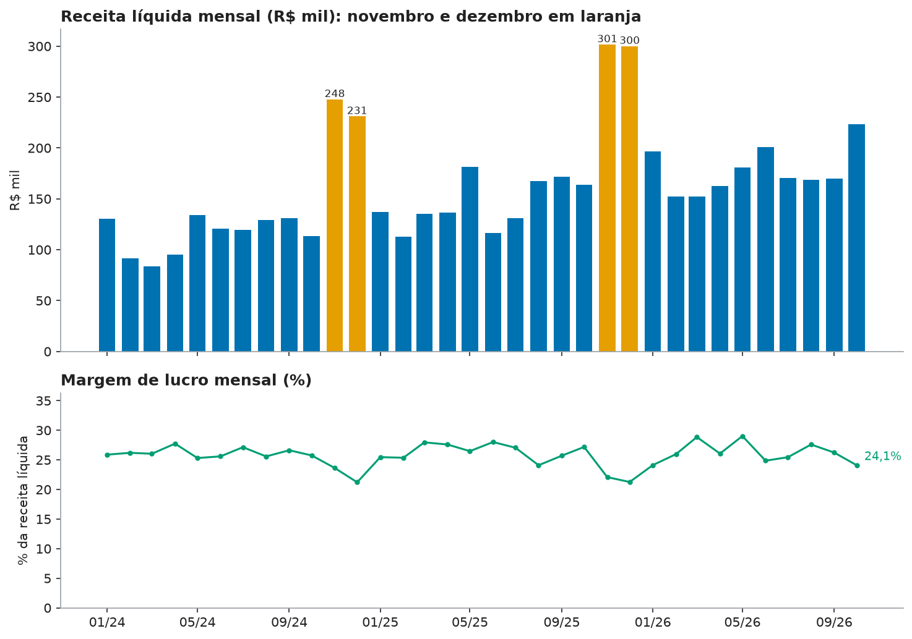
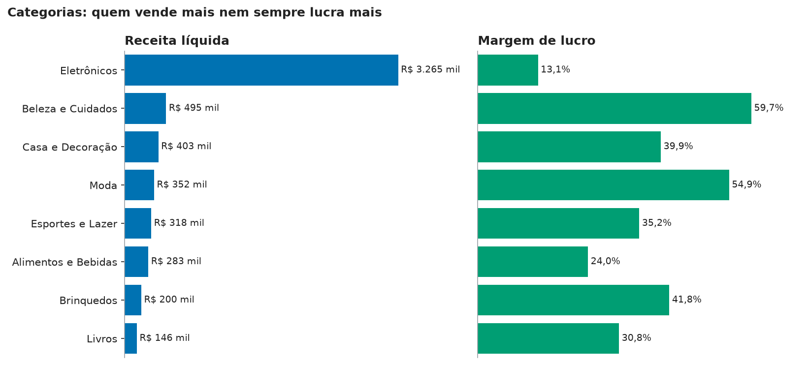
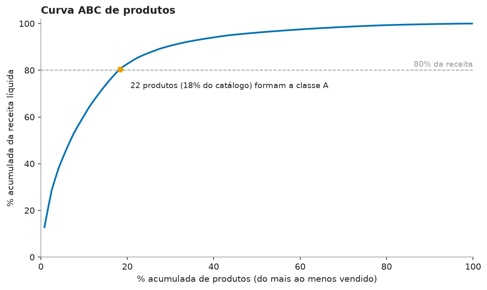
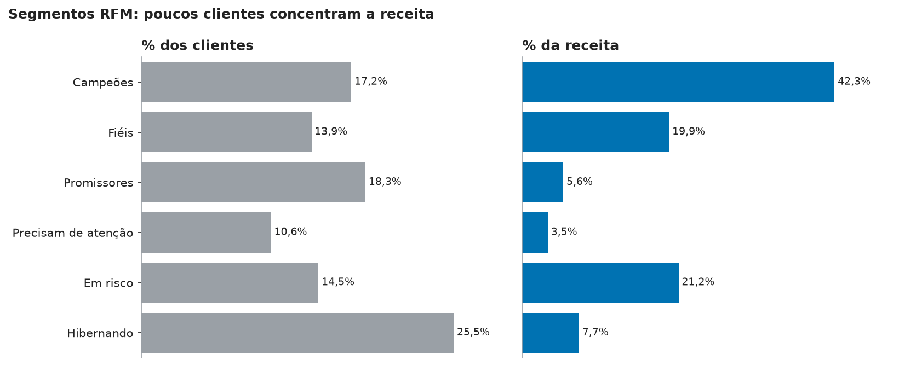
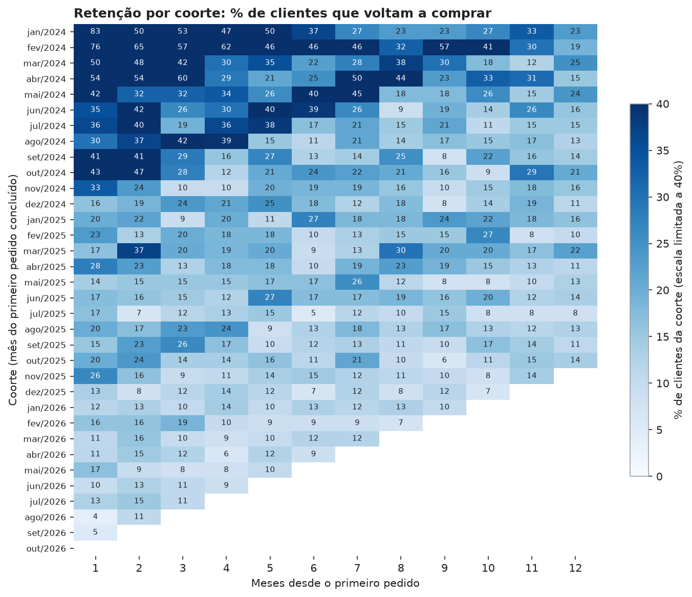
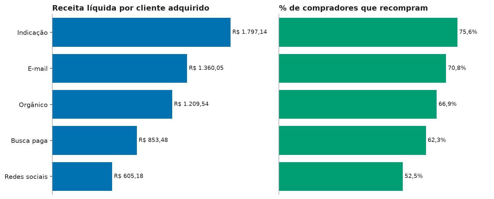
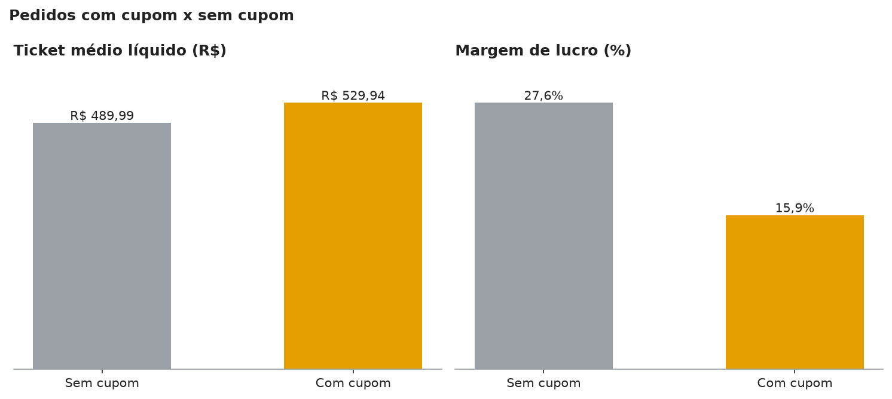
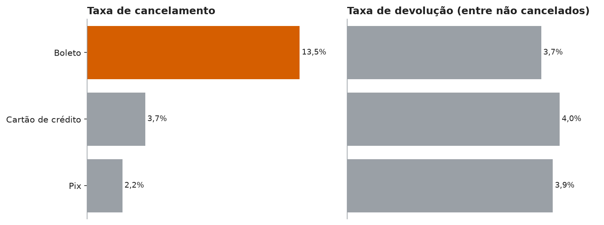
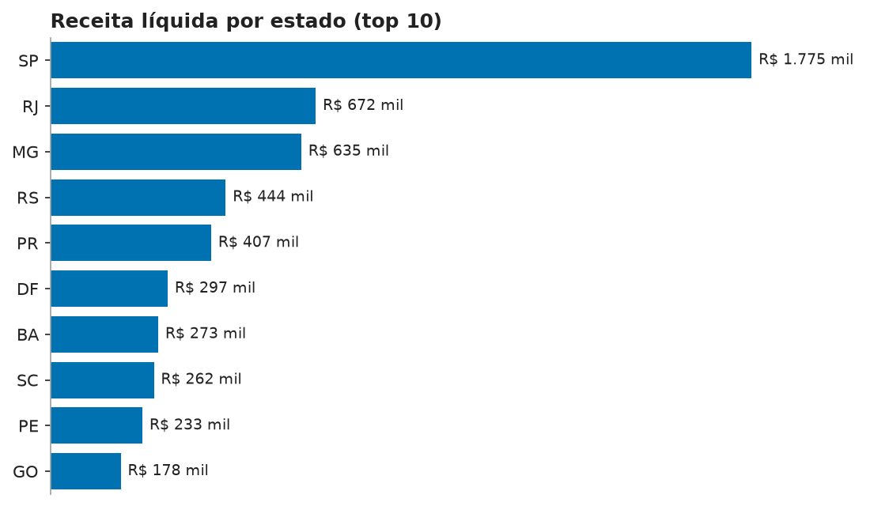

# Relatório de análise: Loja Aurora

> **Dados 100% fictícios**, gerados por script com seed fixa. As conclusões descrevem o conjunto simulado, não um negócio real. Este arquivo é gerado automaticamente por `python -m aurora report`.

## 1. Indicadores principais

Período dos pedidos: 01/01/2024 a 31/10/2026.

| Indicador | Valor |
|---|---|
| Receita líquida | R$ 5.460.733 |
| Lucro bruto | R$ 1.386.335 |
| Margem de lucro | 25,4% |
| Pedidos concluídos | 10.985 |
| Ticket médio líquido | R$ 497,11 |
| Clientes cadastrados | 5.000 |
| Clientes com compra concluída | 2.604 |
| Pedidos cancelados | 565 (4,7%) |
| Pedidos devolvidos | 450 (3,8%) |

Receita líquida = valor dos pedidos concluídos menos o desconto do cupom. Lucro bruto = receita líquida menos o custo dos produtos.

## 2. Receita, lucro e margem mensal

- Melhor mês: **nov/2025**, com R$ 301.491 e margem de 22,1%.
- nov/2024: R$ 247.637, 102,7% acima da média dos dois meses anteriores.
- nov/2025: R$ 301.491, 79,6% acima da média dos dois meses anteriores.
- dez/2024: R$ 230.963, 27,9% acima da média dos dois meses anteriores.
- dez/2025: R$ 299.933, 28,9% acima da média dos dois meses anteriores.
- De janeiro a out/2026, a receita líquida foi R$ 1.777.035, 22,2% acima do mesmo período de 2025 (R$ 1.454.569).
- Margem mensal entre 21,2% e 29,0%.
- Margem média de novembro e dezembro: 22,0%; nos demais meses: 26,3% (diferença de -4,3 p.p.).

Tabela mensal

| Mês | Pedidos | Receita | Lucro | Margem | Var. mês a mês |
|---|---|---|---|---|---|
| jan/2024 | 229 | R$ 130.645 | R$ 33.808 | 25,9% | - |
| fev/2024 | 188 | R$ 91.434 | R$ 23.949 | 26,2% | -30,0% |
| mar/2024 | 181 | R$ 83.445 | R$ 21.720 | 26,0% | -8,7% |
| abr/2024 | 211 | R$ 95.384 | R$ 26.456 | 27,7% | 14,3% |
| mai/2024 | 275 | R$ 134.038 | R$ 33.927 | 25,3% | 40,5% |
| jun/2024 | 257 | R$ 120.794 | R$ 30.905 | 25,6% | -9,9% |
| jul/2024 | 240 | R$ 119.678 | R$ 32.482 | 27,1% | -0,9% |
| ago/2024 | 255 | R$ 129.350 | R$ 33.091 | 25,6% | 8,1% |
| set/2024 | 247 | R$ 130.824 | R$ 34.832 | 26,6% | 1,1% |
| out/2024 | 248 | R$ 113.512 | R$ 29.235 | 25,8% | -13,2% |
| nov/2024 | 498 | R$ 247.637 | R$ 58.496 | 23,6% | 118,2% |
| dez/2024 | 445 | R$ 230.963 | R$ 48.994 | 21,2% | -6,7% |
| jan/2025 | 257 | R$ 137.253 | R$ 34.951 | 25,5% | -40,6% |
| fev/2025 | 215 | R$ 112.968 | R$ 28.654 | 25,4% | -17,7% |
| mar/2025 | 276 | R$ 135.406 | R$ 37.858 | 28,0% | 19,9% |
| abr/2025 | 266 | R$ 136.266 | R$ 37.601 | 27,6% | 0,6% |
| mai/2025 | 363 | R$ 181.650 | R$ 48.090 | 26,5% | 33,3% |
| jun/2025 | 290 | R$ 116.354 | R$ 32.586 | 28,0% | -36,0% |
| jul/2025 | 270 | R$ 131.154 | R$ 35.478 | 27,1% | 12,7% |
| ago/2025 | 318 | R$ 167.733 | R$ 40.408 | 24,1% | 27,9% |
| set/2025 | 337 | R$ 171.751 | R$ 44.147 | 25,7% | 2,4% |
| out/2025 | 328 | R$ 164.035 | R$ 44.580 | 27,2% | -4,5% |
| nov/2025 | 587 | R$ 301.491 | R$ 66.554 | 22,1% | 83,8% |
| dez/2025 | 591 | R$ 299.933 | R$ 63.772 | 21,3% | -0,5% |
| jan/2026 | 332 | R$ 196.358 | R$ 47.340 | 24,1% | -34,5% |
| fev/2026 | 295 | R$ 152.267 | R$ 39.532 | 26,0% | -22,4% |
| mar/2026 | 347 | R$ 152.088 | R$ 43.880 | 28,9% | -0,1% |
| abr/2026 | 342 | R$ 162.677 | R$ 42.395 | 26,1% | 7,0% |
| mai/2026 | 412 | R$ 180.899 | R$ 52.498 | 29,0% | 11,2% |
| jun/2026 | 371 | R$ 200.732 | R$ 49.909 | 24,9% | 11,0% |
| jul/2026 | 372 | R$ 170.196 | R$ 43.314 | 25,4% | -15,2% |
| ago/2026 | 365 | R$ 168.688 | R$ 46.534 | 27,6% | -0,9% |
| set/2026 | 368 | R$ 169.695 | R$ 44.509 | 26,2% | 0,6% |
| out/2026 | 409 | R$ 223.433 | R$ 53.853 | 24,1% | 31,7% |

## 3. Categorias

| Categoria | Unidades | Receita | Margem | % da receita |
|---|---|---|---|---|
| Eletrônicos | 2.263 | R$ 3.264.637 | 13,1% | 59,8% |
| Beleza e Cuidados | 4.782 | R$ 495.092 | 59,7% | 9,1% |
| Casa e Decoração | 2.504 | R$ 403.024 | 39,9% | 7,4% |
| Moda | 2.262 | R$ 351.638 | 54,9% | 6,4% |
| Esportes e Lazer | 1.722 | R$ 317.754 | 35,2% | 5,8% |
| Alimentos e Bebidas | 7.898 | R$ 282.910 | 24,0% | 5,2% |
| Brinquedos | 1.373 | R$ 199.532 | 41,8% | 3,6% |
| Livros | 2.484 | R$ 146.144 | 30,8% | 2,7% |

- Maior receita: **Eletrônicos** (59,8% do total, margem 13,1%).
- Maior margem: **Beleza e Cuidados** (59,7%); menor margem: **Eletrônicos** (13,1%).

## 4. Curva ABC de produtos

- Classe A: 22 produtos; B: 31; C: 67 (total 120).
- Os 24 produtos mais vendidos (20% do catálogo) geram 82,7% da receita líquida.
- Produto líder: **Tablet Essencial** (Eletrônicos), 12,8% da receita.

## 5. Segmentação RFM

| Segmento | Clientes | % clientes | % receita | Pedidos/cliente | Dias desde a última compra |
|---|---|---|---|---|---|
| Campeões | 447 | 17,2% | 42,3% | 10,50 | 47 |
| Fiéis | 362 | 13,9% | 19,9% | 5,79 | 121 |
| Promissores | 477 | 18,3% | 5,6% | 1,38 | 52 |
| Precisam de atenção | 276 | 10,6% | 3,5% | 1,40 | 157 |
| Em risco | 377 | 14,5% | 21,2% | 6,00 | 374 |
| Hibernando | 665 | 25,5% | 7,7% | 1,34 | 428 |

- Campeões: 17,2% dos clientes e 42,3% da receita.
- Em risco (3 ou mais pedidos, mas sem comprar há muito tempo): 377 clientes, 21,2% da receita histórica.

Notas R e M por quintil; F por faixas fixas (1, 2, 3, 4, 5+ pedidos). Veja `src/aurora/analysis/rfm.py`.

## 6. Retenção por coorte

- Retenção média entre as coortes (média simples): mês 1: 26,3%, mês 3: 22,3%, mês 6: 18,1%.
- Coorte = mês do primeiro pedido concluído; cliente "ativo" = fez ao menos um pedido concluído no mês.

## 7. Canais de aquisição

| Canal | Clientes | % que compraram | Receita/cliente | % recompra | Ticket médio | Margem | % cancel. |
|---|---|---|---|---|---|---|---|
| Indicação | 634 | 64,0% | R$ 1.797,14 | 75,6% | R$ 484,02 | 25,8% | 4,8% |
| E-mail | 607 | 59,3% | R$ 1.360,05 | 70,8% | R$ 492,87 | 25,5% | 5,0% |
| Orgânico | 1.498 | 53,8% | R$ 1.209,54 | 66,9% | R$ 511,11 | 25,0% | 4,6% |
| Busca paga | 1.271 | 46,7% | R$ 853,48 | 62,3% | R$ 480,20 | 25,7% | 4,5% |
| Redes sociais | 990 | 44,2% | R$ 605,18 | 52,5% | R$ 520,08 | 25,2% | 4,9% |

- Melhor canal por receita por cliente adquirido: **Indicação** (R$ 1.797,14); pior: **Redes sociais** (R$ 605,18), uma diferença de 3,0x.
- Este relatório não inclui custo de aquisição por canal (a base não tem gasto de marketing), então não calcula CAC nem ROAS.

## 8. Cupons

| Cupom | Desconto | Pedidos | Ticket bruto | Ticket líquido | Margem |
|---|---|---|---|---|---|
| Sem cupom | 0% | 9.028 | R$ 489,99 | R$ 489,99 | 27,6% |
| BEMVINDO10 | 10% | 728 | R$ 612,28 | R$ 551,05 | 19,4% |
| AURORA15 | 15% | 459 | R$ 541,39 | R$ 460,17 | 15,7% |
| CUPOM5 | 5% | 290 | R$ 632,57 | R$ 600,93 | 24,5% |
| NATAL20 | 20% | 256 | R$ 689,16 | R$ 551,32 | 7,9% |
| BLACK25 | 25% | 224 | R$ 650,63 | R$ 487,96 | 0,6% |

- Pedidos com cupom: ticket bruto de R$ 613,11 contra R$ 489,99 sem cupom; após o desconto, R$ 529,94 contra R$ 489,99.
- Margem com cupom: 15,9%; sem cupom: 27,6% (queda de 11,7 p.p.).
- Cupom de pior margem: **BLACK25** (25% de desconto), com margem de 0,6% em 224 pedidos.

## 9. Cancelamento e devolução por forma de pagamento

| Pagamento | Pedidos | Cancelados | % cancel. | Devolvidos | % devol. |
|---|---|---|---|---|---|
| Boleto | 1.796 | 242 | 13,5% | 57 | 3,7% |
| Cartão de crédito | 6.579 | 242 | 3,7% | 255 | 4,0% |
| Pix | 3.625 | 81 | 2,2% | 138 | 3,9% |

- Boleto: 13,5% de cancelamento, contra 3,2% nas demais formas (4,3x).

## 10. Receita por estado

| UF | Compradores | Pedidos | Receita | % da receita | Margem |
|---|---|---|---|---|---|
| SP | 807 | 3.506 | R$ 1.774.894 | 32,5% | 24,9% |
| RJ | 325 | 1.323 | R$ 671.934 | 12,3% | 25,4% |
| MG | 306 | 1.306 | R$ 635.342 | 11,6% | 25,9% |
| RS | 194 | 877 | R$ 444.032 | 8,1% | 26,6% |
| PR | 190 | 783 | R$ 407.293 | 7,5% | 24,2% |
| DF | 113 | 604 | R$ 297.264 | 5,4% | 26,7% |
| BA | 148 | 597 | R$ 273.202 | 5,0% | 25,5% |
| SC | 168 | 638 | R$ 262.286 | 4,8% | 27,0% |
| PE | 108 | 457 | R$ 233.276 | 4,3% | 26,2% |
| GO | 98 | 374 | R$ 178.336 | 3,3% | 24,6% |

- SP, RJ, MG concentram 56,4% da receita.

## 11. Recomendações

1. **Estoque e campanhas sazonais:** concentrar estoque e verba em novembro e dezembro, os meses de pico (melhor mês: nov/2025).
2. **Mix de produtos:** proteger a disponibilidade dos 22 produtos da classe A e revisar os da classe C.
3. **Margem:** priorizar a exposição de Beleza e Cuidados (margem 59,7%) e revisar preço ou custo de Eletrônicos (margem 13,1%).
4. **Retenção:** criar réguas de reativação para os clientes do segmento "Em risco" e programa de fidelidade para os Campeões.
5. **Canais:** investir mais em Indicação e reavaliar Redes sociais, após cruzar com o custo de aquisição (não disponível nesta base).
6. **Cupons:** rever o desconto do cupom BLACK25 (margem de 0,6%); em média, pedidos com cupom têm margem 11,7 p.p. menor.
7. **Pagamento:** incentivar Pix no lugar de boleto (cancelamento de 13,5% no boleto).

## Limitações

- Os dados são simulados: padrões como sazonalidade e a diferença do boleto foram embutidos de propósito no gerador.
- Não há custo de frete, de marketing nem estoque; o lucro é bruto (receita líquida menos custo do produto).
- Cancelados e devolvidos são excluídos da receita; não há estorno parcial nem data de devolução.
